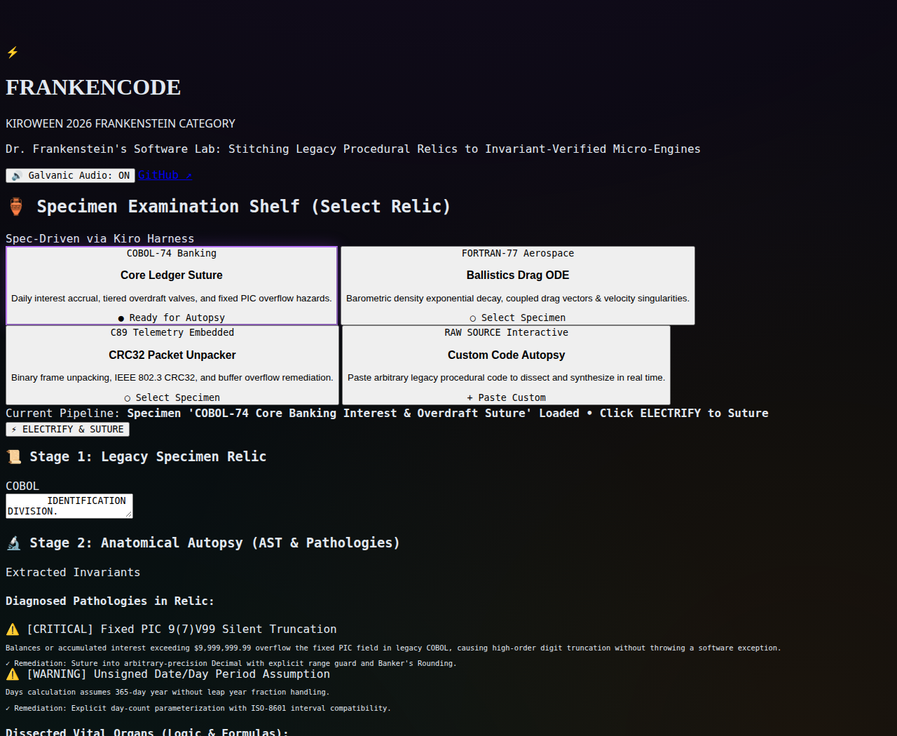

# FrankenCode

[](LICENSE)
[](https://www.python.org/)
[](tests/)
[](https://github.com/ArtyormSatori/frankencode/actions)

**Modernize legacy code without changing what it does.** FrankenCode takes old COBOL, Fortran, or C code, extracts the math that matters, rewrites it in Python, TypeScript, or Rust, then checks the rewrite against the original with property-based tests. Built for Kiroween 2026 (Frankenstein track).



## How it works

1. Pick a sample — a COBOL banking ledger, a Fortran ballistics routine, a C telemetry parser — or paste your own code.
2. It parses the code, pulls out the formulas, and flags the hazards: silent truncation, missing bounds checks, unsafe date math.
3. It rewrites the code in Python 3.13, TypeScript, or Rust.
4. Hypothesis runs 100+ randomized inputs through both versions and reports any difference. No difference, no merge.

## Try it

```bash
git clone https://github.com/ArtyormSatori/frankencode.git
cd frankencode
./run.sh            # installs deps, starts the cockpit at http://localhost:8000
```

Pick the COBOL ledger, click **Electrify & Suture**, and watch the invariants get checked.

## Tests & benchmarks

```bash
./run.sh test       # 16 tests
./run.sh benchmark  # latency + memory, writes BENCHMARK_RESULTS.md
```

## MCP server

```bash
./run.sh mcp        # JSON-RPC over stdio
```

Tools: `dissect_legacy_code`, `suture_specimen`, `verify_invariants`, `benchmark_sandbox`. Works with Kiro IDE, CLI, and custom agents.

## License

Apache-2.0 — see [LICENSE](LICENSE).
